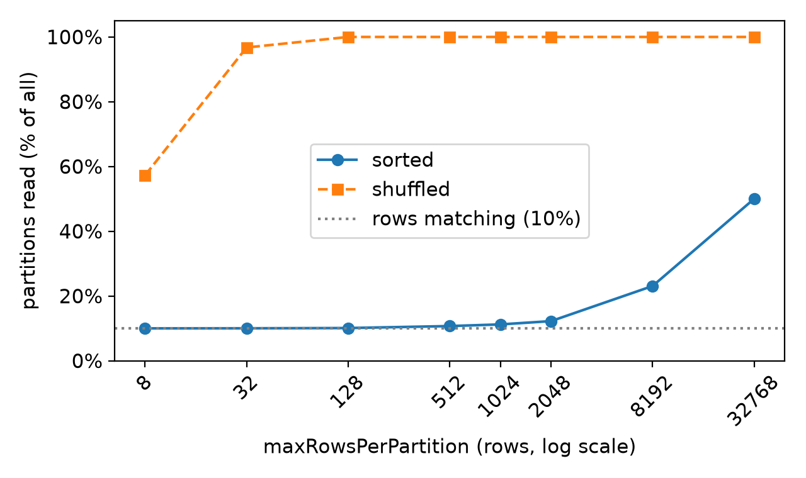
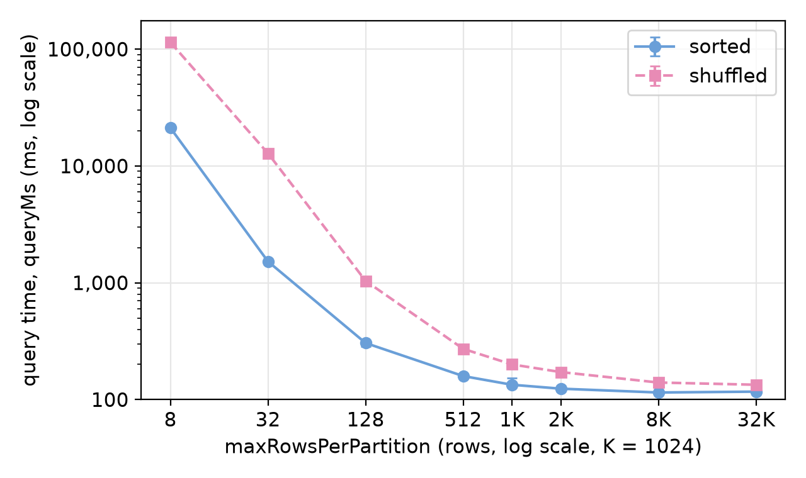
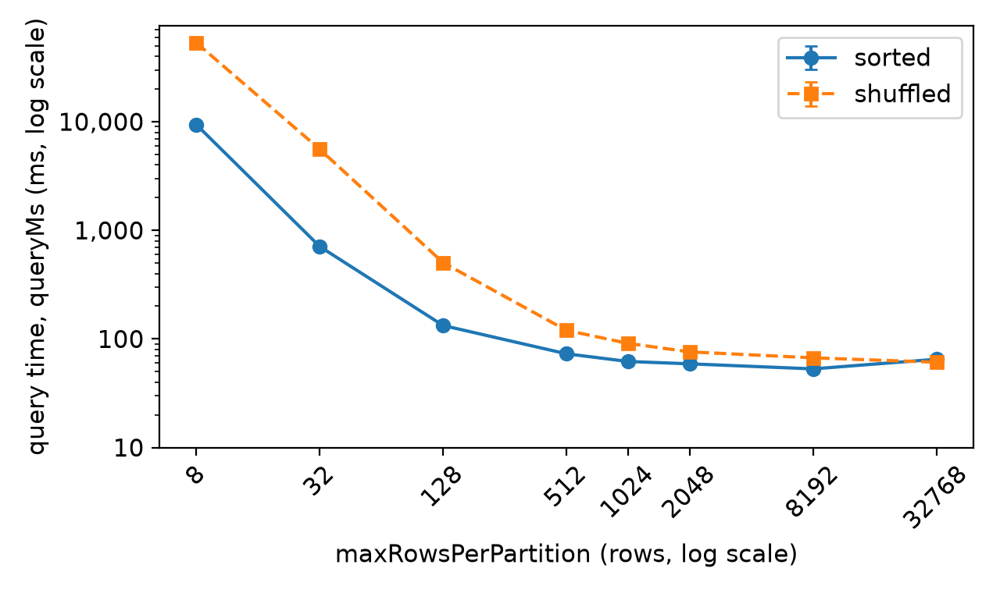

# Experiment results

Both machines ran the same sweep at commit `12e77e9`, same seed and same heap.
The partitions-read columns are identical on both; only the times differ.

Partitions read and median `queryMs` of runs 2 to 6.

## Latitude 5320

Conditions, every run and the summary are in [results/latitude-5320](results/latitude-5320).

| maxRowsPerPartition | read, sorted | read, shuffled | ms, sorted | ms, shuffled |
|---|---|---|---|---|
| 8 | 10.0% | 57.3% | 21,194 | 114,504 |
| 32 | 10.0% | 96.7% | 1,522 | 12,828 |
| 128 | 10.1% | 100.0% | 305 | 1,038 |
| 512 | 10.7% | 100.0% | 159 | 272 |
| 1024 | 11.2% | 100.0% | 134 | 200 |
| 2048 | 12.2% | 100.0% | 124 | 172 |
| 8192 | 23.1% | 100.0% | 115 | 140 |
| 32768 | 50.0% | 100.0% | 117 | 134 |

## MacBook Pro

Conditions, every run and the summary are in [results/macbook-pro](results/macbook-pro).

| maxRowsPerPartition | read, sorted | read, shuffled | ms, sorted | ms, shuffled |
|---|---|---|---|---|
| 8 | 10.0% | 57.3% | 9,385 | 53,323 |
| 32 | 10.0% | 96.7% | 709 | 5,575 |
| 128 | 10.1% | 100.0% | 133 | 504 |
| 512 | 10.7% | 100.0% | 73 | 120 |
| 1024 | 11.2% | 100.0% | 62 | 91 |
| 2048 | 12.2% | 100.0% | 59 | 76 |
| 8192 | 23.1% | 100.0% | 53 | 67 |
| 32768 | 50.0% | 100.0% | 65 | 61 |

